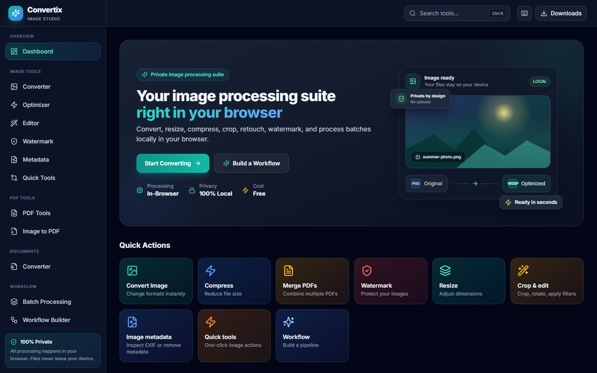
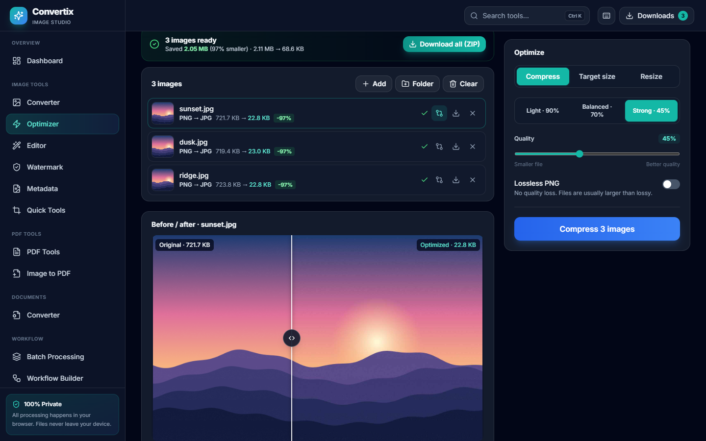
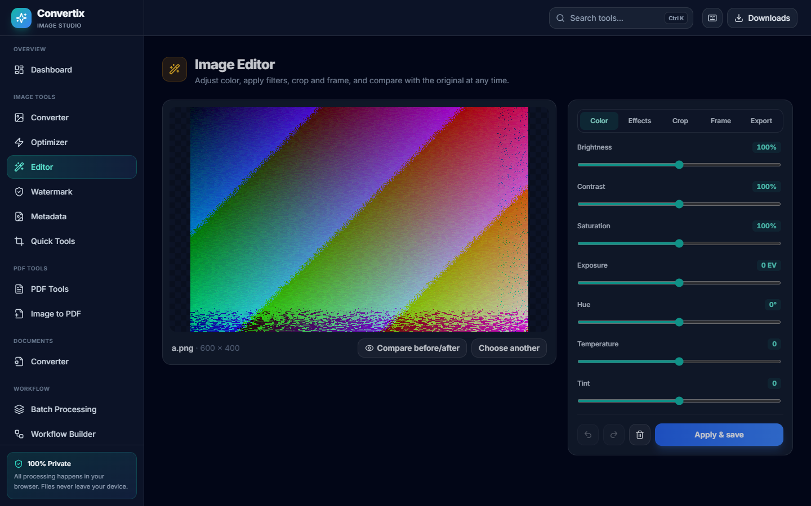
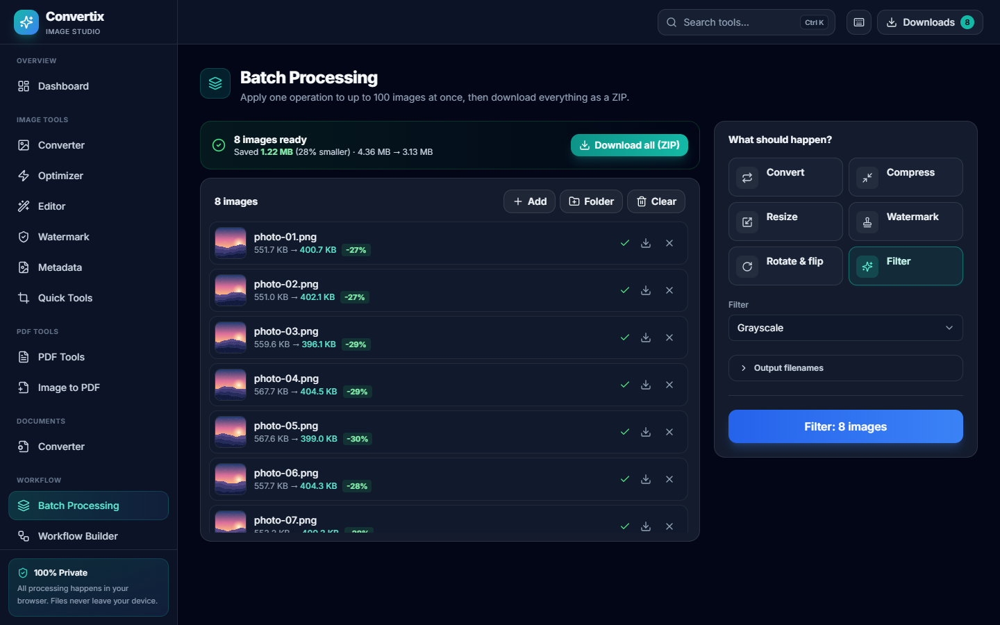
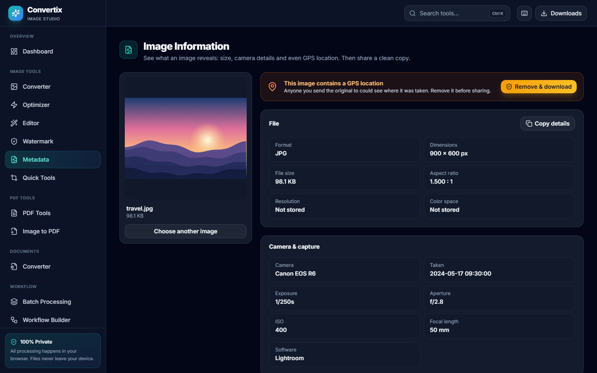
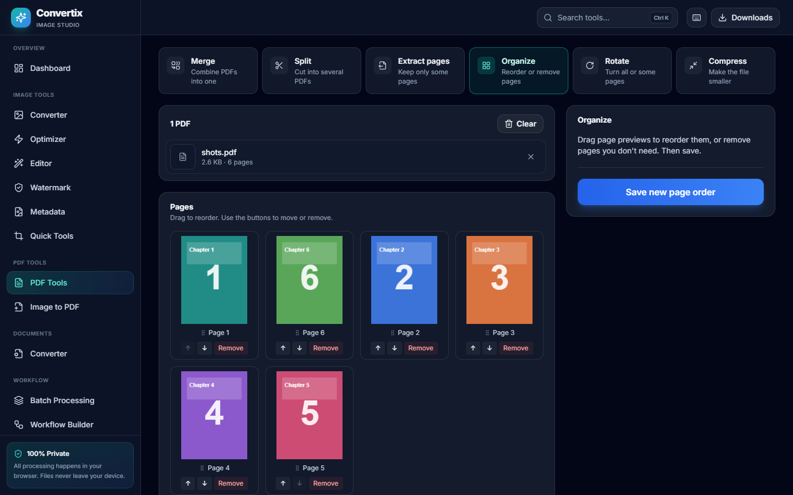
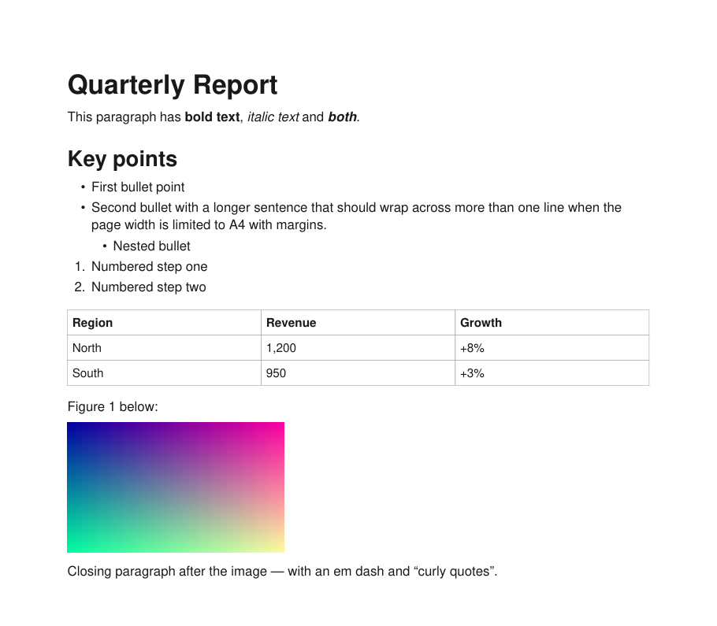

<div align="center">


# Convertix

**Convert, compress, edit and watermark images — plus PDF and Word tools — entirely in your browser.**
Your files are processed on your own device. They are never uploaded.

<!-- TODO: add the live demo link here once deployed: [**Live demo →**](https://your-domain) -->



</div>

## Why it's private

Most online converters upload your files to a server. Convertix doesn't have one. Every operation runs client-side with the Canvas API, Web Workers and a few WebAssembly/JS libraries, so photos, scans and contracts stay on the machine they came from.

This is easy to check: open the browser's Network tab and process a file. The only third-party requests are the Inter typeface from Google Fonts; there are no uploads and no request bodies.

## Features

**Images**
- **Convert** between PNG, JPG, WebP and BMP. Reads HEIC/HEIF, TIFF, AVIF, GIF and ICO as input. Only offers output formats your browser can really encode.
- **Optimize**: lossy or lossless compression, *target file size* (binary-searches JPEG quality, then downsizes if needed), and resize with fit / fill / stretch / percentage modes and social-media presets. A **before/after slider** (drag or arrow keys) shows what you gave up, and a banner reports the total saved.
- **Edit** with live preview in five tabs (Color, Effects, Crop, Frame, Export): brightness, contrast, saturation, exposure, filters, crop with aspect presets, rounded corners, borders, shadows, mockups. Undo/redo, and compare with the original at any time, even before applying.
- **Watermark** with text or a logo. The preview is drawn by the same code as the export, so what you see is what you get.
- **Image information** shows camera details and **warns when a photo contains a GPS location**, then exports a clean copy.
- **Quick tools**: eight one-click actions (compress, WebP, resize to 1080p, square crop, thumbnail, exact file size, remove metadata, fix orientation) that work on many images at once.

**PDF and documents**
- Merge (**drag to reorder** the files), split by **page ranges** (`1-3, 5, 8-10`) or into single pages, extract pages, rotate all or **selected pages**, and organize (**drag** page thumbnails to reorder, remove pages).
- **Compress PDF** in two modes: lossless optimize, or *recompress pages* (render to JPEG with quality and DPI controls; a test PDF of full-page images went from 4.9 MB to 105 KB, at the cost of selectable text).
- **Images → PDF** from any supported format: fit-to-image pages, or **A4 / US Letter** with automatic orientation and margins. Drag to reorder pages.
- **DOCX → PDF** keeping headings, bold/italic/underline, links, nested lists, tables and images. **TXT → PDF** and **PDF → PNG/JPG** too.

**Batch and automation**
- **Batch processing** of up to 100 images in parallel on a worker pool, with a **Cancel** button, filename patterns (`{name}`, `{index}`, `{operation}`, `{ext}` that rename finished files instantly) and ZIP download.
- **Workflow builder**: chain steps (resize, crop, watermark, filters, compress, convert), start from a template, and save your own. The pipeline is remembered between visits.

**How it feels**
- One layout for every file tool: a single focused drop area first, then your files as thumbnails with the settings beside them. Rows turn into results in place ("PNG → WEBP · 978 KB → 12 KB · -99%"), with a summary on top.
- Tools **remember your last-used options**, and Settings can clear them.
- `Ctrl+K` or `/` to search tools, `G` then a letter to jump to a page, `?` for the full list. **Paste** an image or file with `Ctrl+V` on any upload screen.
- Keyboard accessible controls (radio groups, tabs and sliders), visible focus, labelled buttons, and a layout that works on phones. An automated axe-core scan (WCAG 2.1 A/AA) of every page reports no violations; that is a useful floor, not a substitute for testing with real assistive technology.
- **Folder uploads get a review popup**: after you pick or drop a folder you see how many images were found, what will be skipped and why (text files, hidden system files…), the per-run limit, the total size, and an "Include subfolders" switch, and nothing is added until you confirm. In Chrome and Edge the folder button uses the File System Access API (`showDirectoryPicker`, read-only), which avoids the old "Upload N files to this site?" message; other browsers fall back to a standard folder input, where the browser shows its own confirmation that a page cannot remove. Dropping a folder never shows a browser prompt.
- Custom popups instead of browser alerts: success / error / warning / info notifications with a countdown that pauses on hover (repeats merge into one with a counter), and a keyboard-accessible confirm dialog for destructive actions such as clearing the session. The app never uses `alert()` or `confirm()`.
- Recovers gracefully: unknown URLs show a "Page not found" screen, and a crash or a page that fails to load shows a recovery screen instead of going blank.

## Screenshots

| Optimizer with before/after | Image editor |
| :--: | :--: |
|  |  |

| Batch processing | Image information (GPS warning) |
| :--: | :--: |
|  |  |

| PDF page organizer (drag to reorder) | DOCX → PDF output |
| :--: | :--: |
|  |  |

## Tech stack

| | |
| --- | --- |
| UI | React 18, React Router 6, Tailwind CSS 3, Framer Motion, lucide-react |
| Build / test | Vite 7, Vitest 5 (jsdom) |
| Images | Canvas / OffscreenCanvas, `heic2any`, `utif` (TIFF), `piexifjs` (EXIF) |
| PDF / docs | `pdf-lib` (create and edit), `pdfjs-dist` (render), `mammoth` (DOCX → HTML), `jszip` |

No backend, no database, no AI services.

## Which package does what

Everything runs in the browser with React: there is no backend, no server code and no API. Each feature below is built from the listed package, from standard browser APIs, or from our own code.

### Packages
| Feature or task | Package | Notes |
| --- | --- | --- |
| UI, components, state, hooks, contexts | `react`, `react-dom` | The whole app, including the shared `useImageBatch` hook |
| Pages, navigation, links, 404 page | `react-router-dom` | 14 pages plus a catch-all; pages load on demand with `React.lazy` |
| Styling, dark theme, responsive layout | `tailwindcss`, `postcss`, `autoprefixer` | Custom colour tokens in `tailwind.config.js` |
| Icons | `lucide-react` | |
| Animations: popups, dialogs, progress bars, page transitions | `framer-motion` | Popups and dialogs switch to plain fades when the system asks for reduced motion |
| Reading HEIC / HEIF photos | `heic2any` | Loaded only when a HEIC file is opened |
| Reading TIFF images | `utif` | Loaded only when a TIFF file is opened |
| JPEG EXIF: read, keep, strip, GPS detection | `piexifjs` | The friendly camera summary and GPS warning are our own code on top of it |
| PDF merge, split, rotate, extract, reorder, remove pages | `pdf-lib` | |
| PDF compress, Images → PDF, TXT → PDF | `pdf-lib` | "Recompress pages" also uses `pdfjs-dist` to render each page |
| PDF page previews, PDF → PNG/JPG | `pdfjs-dist` | Its worker script is bundled, not fetched from a CDN |
| DOCX → PDF | `mammoth` + `pdf-lib` | `mammoth` turns the Word file into HTML; our `htmlToPdf` layout engine draws it with `pdf-lib` |
| ZIP downloads | `jszip` | Used by every "Download all" button |
| Dev server, production build, code splitting, background-worker bundling | `vite`, `@vitejs/plugin-react` | |
| Unit tests | `vitest`, `jsdom` | |
| Linting | `eslint`, `@eslint/js`, `eslint-plugin-react-hooks`, `eslint-plugin-react-refresh`, `globals` | |

`@types/react` and `@types/react-dom` are editor-only type hints.

### No package needed (browser APIs and our own code)
| Feature or task | How it's done |
| --- | --- |
| Convert, compress, resize, crop, filters, adjustments, watermark | Canvas and `OffscreenCanvas` |
| Keeping the page responsive on big batches | Web Workers and `createImageBitmap`, with a small worker pool of our own |
| BMP export, target-file-size compression, "can this browser encode WebP?" check | Our own code on top of canvas |
| Reading JPG, PNG, WebP, AVIF, GIF, ICO | The browser's built-in image decoder |
| Cancel button for batches | `AbortController` |
| Drag-to-reorder (files, PDF pages) and dropping files or folders | HTML5 drag and drop, plus our `useDragReorder` hook |
| Choosing a folder | File System Access API (`showDirectoryPicker`) in Chrome and Edge, with a standard folder input as the fallback |
| Paste an image from the clipboard | Clipboard events |
| Before/after slider | Our own `BeforeAfterSlider` component |
| Remembered settings and saved workflows | `localStorage` through our `usePersistentState` hook |
| Keyboard shortcuts and the shortcuts dialog | Our own code |
| Custom popups, confirm dialogs, folder review popup | Our own components (animated with `framer-motion`) |
| Skeleton loading and the loading screen on refresh | CSS and a static shell in `index.html` |
| Page ranges (`1-3, 5`), filename patterns, EXIF summary, savings totals, download memory cap | Small utilities in `src/utils` |
| Workflow builder and batch queue | Our own code on top of the shared image pipeline |

## How it works

```
 Page (React)                    builds a list of plain "steps"  { type: 'convert', format: 'webp', quality: 80 }
     │
     ▼
 imageProcessor.js               pool of up to 4 Web Workers, results returned in input order
     │   falls back to the main thread if Workers / OffscreenCanvas are missing,
     │   or if a file needs DOM-only decoding (HEIC)
     ▼
 image.worker.js → imageOps.js   runs the steps in order, feeding each output into the next
     ▼
 imageService.js                 canvas pipeline that works with both <canvas> and OffscreenCanvas
```

The same step description drives Batch, Workflow, the Converter, the Optimizer and Quick Tools, so there is one code path to test and maintain. On the UI side, the `useImageBatch` hook owns the queue, progress, cancel, retry, ZIP download and hand-off to the Downloads list, and a small component kit (`FileWorkbench`, `FileRows`, `Segmented`, `Slider`, `Tabs`, …) gives every tool the same layout.

## What was hard

- **One image pipeline, two environments.** The original code used `document.createElement('canvas')` and `` everywhere. Moving it into a Web Worker meant abstracting canvas creation, decoding (`createImageBitmap` instead of `Image`), and encoding (`convertToBlob` instead of `toBlob`) without changing behaviour on the main thread. Measured in Edge on one machine (indicative, not a benchmark): ten noisy 1200×900 PNGs with the "vintage" filter took about 1.0 s on four workers versus 1.6–2.1 s on the main thread, and the longest UI stall was 44–56 ms versus 72–85 ms. For small or simple images (smooth JPEGs) there was no measurable difference, so the gain shows up on heavy batches.
- **Browsers lie about encoding.** `canvas.toBlob('image/webp')` silently returns a PNG where WebP isn't supported. Convertix detects what the browser can actually encode and verifies the returned MIME type, rather than shipping a `.webp` that is really a PNG.
- **Real DOCX → PDF without a server.** `mammoth` produces semantic HTML; a small parser turns it into blocks (headings, runs, lists, tables, images) and a layout engine wraps text, switches between four Helvetica faces, paginates, and keeps headings with the lines that follow. The parser is separate from the renderer so it can be unit-tested without drawing.
- **Honest PDF compression.** In-browser, "lossless" PDF compression barely shrinks anything. So there is a second mode that rasterizes pages, and the UI says plainly what you lose (selectable text) and refuses to return a file bigger than the original.
- **Consistency without a framework.** Eleven tools had grown eleven private versions of the same controls, and the Editor put ~30 controls in one panel. Pulling the shared pieces into one kit (and splitting the Editor into tabs) made the UI calmer and made the page files about a quarter shorter (the shared kit adds code of its own, but it is written once). It also surfaced real bugs: the watermark preview never drew logos, and watermark positions were computed inconsistently (text clipped at the edges, logos landing off-center).
- **Memory.** Processed files live in memory so they can be downloaded later. They are capped (300 MB / 200 files, oldest dropped first, with a notice), object URLs are revoked, and idle workers are terminated.

## Getting started

```bash
npm install
npm run dev        # http://localhost:5173
npm run build      # production build in dist/
npm run preview    # serve the production build
npm test           # unit tests (Vitest)
npm run lint       # ESLint (JS/JSX, React hooks rules)
```

> **Windows:** run tests with `npm test`, not `npx vitest`. A lowercase drive letter in the working directory (`e:\...`) makes Vitest load two copies of itself; `scripts/test.mjs` normalizes the path.

## Project structure

```
src/
  pages/        one file per tool (Converter, Optimizer, Editor, PdfTools, …)
  components/   Dropzone (drag, folder, paste), BeforeAfterSlider, …
    ui/         design kit: PageHeader, Panel, Segmented, Slider, Tabs, FileWorkbench, FileRows, ResultsBanner, …
  services/     imageService, imageOps, imageProcessor (worker pool), pdfService, htmlToPdf, documentService
  workers/      image.worker.js
  context/      settings, session downloads (with memory cap), toast feedback
  hooks/        useImageBatch, usePersistentState, useDragReorder, useObjectUrl, useSupportedFormats
  utils/        filename patterns, page ranges, EXIF summary, result stats, zip, formatting, reorder
public/         favicon and social preview image
docs/           README screenshots
```

## Limitations

- **DOCX → PDF** reproduces basic formatting only: no page layout, columns, text boxes, headers/footers or custom fonts. PNG and JPEG images are kept; other image types are replaced by a placeholder. Text outside Latin-1 (for example Cyrillic or CJK) becomes `?`, because the standard PDF fonts don't cover it.
- **PDF "recompress pages"** turns pages into images, so text is no longer selectable or searchable.
- **HEIC/HEIF** is decoded on the main thread (the decoder needs the DOM), so large HEIC batches don't get the worker speed-up.
- Images are limited to 100 MB and 100 megapixels each; batches to 100 files.
- Needs a modern browser. Without `OffscreenCanvas`/Workers everything still works, just on the main thread.
